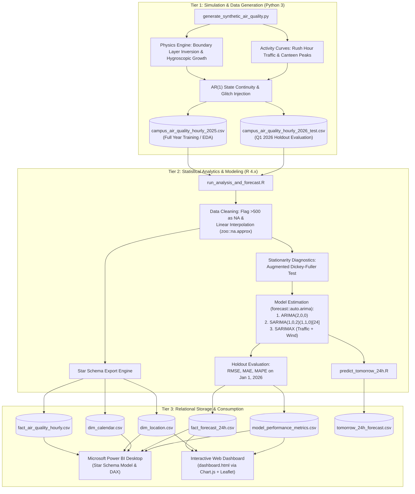
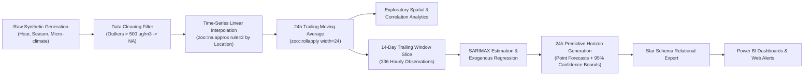
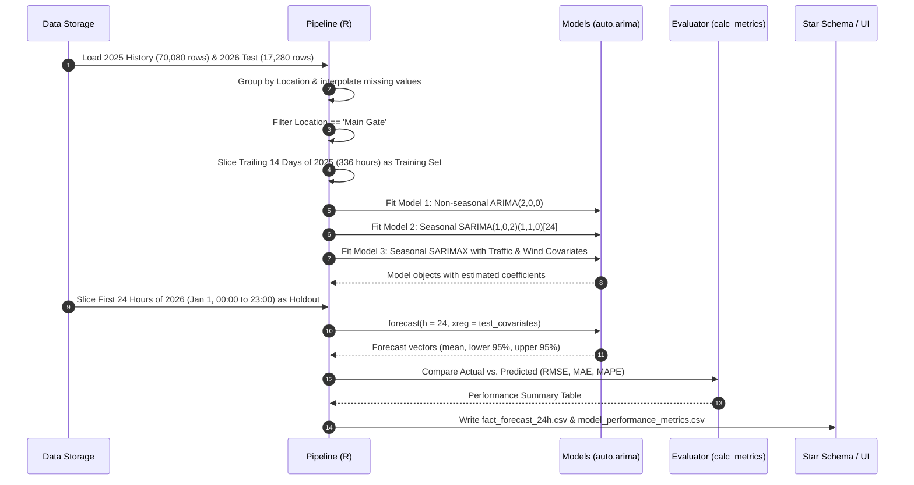

# System Architecture & Component Design

This document details the modular architecture, component responsibilities, end-to-end execution workflow, and file inventory of the **Campus Air Quality Monitoring, Analysis, and Forecasting** platform.

---

## 🏛️ System Architecture Overview

The system is organized into three distinct tiers:
1. **Simulation & Data Generation Tier (Python)**: A dependency-free physics engine that simulates atmospheric chemistry, diurnal meteorological cycles, student/vehicular movement patterns, and sensor hardware degradation.
2. **Statistical Analytics & Modeling Tier (R)**: An end-to-end analytics pipeline that performs anomaly filtering, linear interpolation, stationarity hypothesis testing (ADF), model fitting (ARIMA, SARIMA, SARIMAX), out-of-sample holdout evaluation, and dimensional export.
3. **Consumption & Decision Support Tier (Power BI & HTML5/JS)**: A dual visualization interface comprising an enterprise dimensional Star Schema for Microsoft Power BI and a zero-dependency web application (`dashboard.html`) utilizing Leaflet.js and Chart.js.

### High-Level System Architecture Diagram

---

## 🔄 End-to-End Data Flow

The following data-flow diagram tracks the exact transformation stages of environmental records from initial generation to decision support:

---

## 🔬 Model Training & Evaluation Workflow

The evaluation workflow adheres strictly to temporal ordering, ensuring that future data never contaminates model parameter estimation:

---

## 📂 Verified File Inventory

Every significant file in the workspace serves a specific, verified operational purpose:

### 1. Source Scripts & Applications
* **[`generate_synthetic_air_quality.py`](../generate_synthetic_air_quality.py)**:
  * **Role**: Primary data simulation engine.
  * **Language**: Python 3 (built exclusively with standard library modules: `csv`, `math`, `random`, `datetime`).
  * **Output**: Generates `campus_air_quality_hourly_2025.csv` and `campus_air_quality_hourly_2026_test.csv`.
* **[`run_analysis_and_forecast.R`](../run_analysis_and_forecast.R)**:
  * **Role**: Main analytics and time-series modeling engine.
  * **Language**: R 4.x (utilizing `forecast`, `zoo`, `dplyr`, `tseries`, `ggplot2`).
  * **Output**: Cleans data, runs ADF test, trains ARIMA/SARIMA/SARIMAX, evaluates 24h performance, and exports all Star Schema tables.
* **[`predict_tomorrow_24h.R`](../predict_tomorrow_24h.R)**:
  * **Role**: Dedicated operational forecasting script for day-ahead campus management.
  * **Language**: R 4.x.
  * **Output**: Fits the champion SARIMAX model, predicts the next 24 hours, maps outputs to official AQI categories and health advisories, and flags the peak pollution hour in `tomorrow_24h_forecast.csv`.
* **[`dashboard.html`](../dashboard.html)**:
  * **Role**: Interactive web dashboard for cross-platform visual exploration.
  * **Language**: HTML5, Vanilla JavaScript, Tailwind CSS (CDN), Chart.js (CDN), Leaflet.js (CDN).
  * **Output**: Renders the campus map, 24-hour forecast curve with shaded 95% confidence intervals, and activity correlation scatter plots.

### 2. Configuration & Documentation Files
* **[`POWER_BI_DASHBOARD_GUIDE.md`](../POWER_BI_DASHBOARD_GUIDE.md)**: Comprehensive implementation guide detailing Star Schema relationships, DAX measure code, and report page configurations for Microsoft Power BI Desktop.
* **[`decisions.md`](../decisions.md)**: Architectural and technical decisions log detailing rationale, alternatives considered, trade-offs, and consequences for each major engineering choice.
* **[`flow.md`](../flow.md)**: Low-level execution trace and module interaction reference.
* **[`README.md`](../README.md)**: High-level repository landing page and project overview.
* **[`.gitignore`](../.gitignore)**: Git exclusion rules for operating system artifacts and temporary directories.

### 3. Generated Datasets & Relational Tables
* **`campus_air_quality_hourly_2025.csv`**: Raw simulated dataset for full year 2025 (70,080 rows; 8,760 hours $\times$ 8 locations). Contains synthetic sensor glitches for testing data cleaning.
* **`campus_air_quality_hourly_2026_test.csv`**: Raw simulated holdout dataset for Q1 2026 (17,280 rows; 2,160 hours $\times$ 8 locations). Used for out-of-sample model evaluation.
* **`fact_air_quality_hourly.csv`**: Cleaned, imputed fact table containing environmental measurements, calculated 24-hour rolling averages, and AQI categories for 2025 (70,080 rows).
* **`dim_location.csv`**: Location dimension table containing GPS coordinates (latitude/longitude), facility classifications (indoor vs. outdoor), and regulatory thresholds for all 8 campus stations.
* **`dim_calendar.csv`**: Temporal dimension table containing hourly timestamps, date components, day of the week, month names, and weekend flags spanning 2025-01-01 through 2026-03-31 (10,944 rows).
* **`fact_forecast_24h.csv`**: 24-hour forecast evaluation table comparing actual holdout measurements against SARIMA and SARIMAX predictions, complete with 95% prediction intervals.
* **`model_performance_metrics.csv`**: Benchmark table recording the exact RMSE, MAE, and MAPE metrics for ARIMA, SARIMA, and SARIMAX.
* **`tomorrow_24h_forecast.csv`**: Operational forecast schedule generated by `predict_tomorrow_24h.R`, detailing hourly predictions, confidence bounds, expected vehicles, wind speed, AQI category, and safety actions.

---

## 🚀 Workflow Entry Points

The project supports three primary operational workflows initiated via terminal commands:

| Workflow | Entry Command | Primary Script | Artifacts Produced |
| :--- | :--- | :--- | :--- |
| **1. Data Simulation** | `python3 generate_synthetic_air_quality.py` | `generate_synthetic_air_quality.py` | `campus_air_quality_hourly_2025.csv` `campus_air_quality_hourly_2026_test.csv` |
| **2. Analytics & Modeling Pipeline** | `Rscript run_analysis_and_forecast.R` | `run_analysis_and_forecast.R` | `fact_air_quality_hourly.csv` `dim_location.csv` `dim_calendar.csv` `fact_forecast_24h.csv` `model_performance_metrics.csv` |
| **3. Operational 24h Prediction** | `Rscript predict_tomorrow_24h.R` | `predict_tomorrow_24h.R` | `tomorrow_24h_forecast.csv` |
| **4. Web Dashboard Visualizer** | `python3 -m http.server 8080` | `dashboard.html` | Browser rendering at `http://localhost:8080/dashboard.html` |
