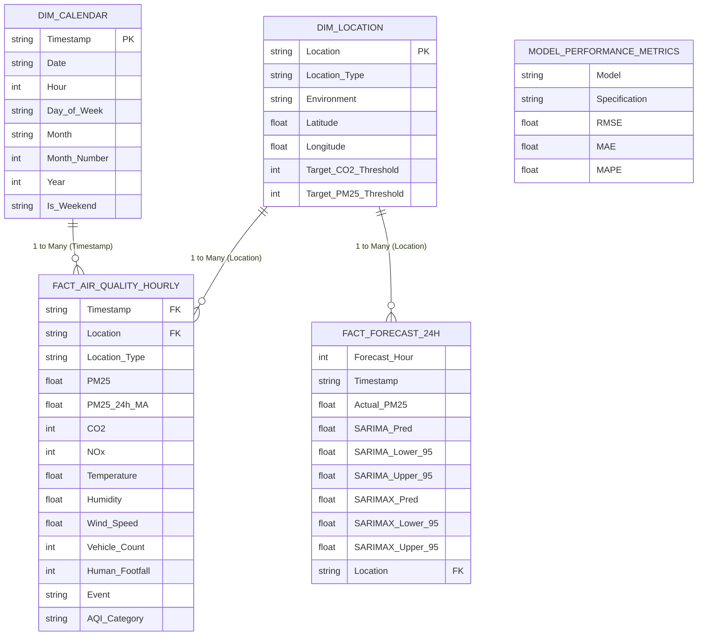

# Visual Dashboards: Power BI Star Schema & Standalone Web App

This document provides complete implementation specifications for both visualization environments supported by the project:
1. **The Enterprise Microsoft Power BI Star-Schema Model**: Dimensional data architecture, relationship cardinality, DAX measures, and report page configurations.
2. **The Standalone Interactive Web Dashboard (`dashboard.html`)**: A cross-platform, zero-dependency browser application utilizing Leaflet.js and Chart.js.

---

## 🌟 Power BI Data Model Architecture (Star Schema)

The analytical data layer decomposes flat time-series records into a formal **Kimball Star Schema**. This dimensional structure maximizes VertiPaq in-memory compression in Power BI, optimizes filter propagation, and simplifies DAX measure formulation.



### Table Inventory & Relationships
1. **`fact_air_quality_hourly.csv` (Central Fact Table)**:
   * 70,080 hourly records covering the full year 2025 across all 8 micro-locations.
   * Granularity: 1 row per Location per Hour.
2. **`dim_location.csv` (Location Dimension Table)**:
   * 8 rows containing station metadata: GPS coordinates (Latitude/Longitude), facility classifications (Indoor vs. Outdoor), and safety threshold limits.
   * Key: `Location` ($1 \rightarrow *$ relationship to fact tables).
3. **`dim_calendar.csv` (Temporal Dimension Table)**:
   * 10,944 rows covering hourly timestamps from `2025-01-01 00:00:00` to `2026-03-31 23:00:00`.
   * Key: `Timestamp` ($1 \rightarrow *$ relationship to fact table).
4. **`fact_forecast_24h.csv` (Forecasting Fact Table)**:
   * 24 hourly rows detailing out-of-sample holdout actuals, SARIMA predictions, SARIMAX predictions, and 95% confidence bounds.
5. **`model_performance_metrics.csv` (Benchmark Table)**:
   * Standalone summary table of RMSE, MAE, and MAPE metrics across ARIMA, SARIMA, and SARIMAX.

---

## 📐 Complete DAX Measure Library

To implement the dashboard in Power BI Desktop, create a dedicated measures table named `_Measures` and insert the following formulas:

### 1. Primary Physical Aggregations
```dax
Avg_PM25 = 
AVERAGE(fact_air_quality_hourly[PM2.5])

Avg_CO2 = 
AVERAGE(fact_air_quality_hourly[CO2])

Avg_NOx = 
AVERAGE(fact_air_quality_hourly[NOx])

Total_Vehicle_Traffic = 
SUM(fact_air_quality_hourly[Vehicle_Count])

Total_Footfall = 
SUM(fact_air_quality_hourly[Human_Footfall])
```

### 2. Time-Intelligence 24-Hour Rolling Moving Average
```dax
24h_Rolling_Avg_PM25 = 
VAR CurrentTime = MAX(fact_air_quality_hourly[Timestamp])
RETURN
    CALCULATE(
        AVERAGE(fact_air_quality_hourly[PM2.5]),
        DATESINPERIOD(dim_calendar[Date], MAX(dim_calendar[Date]), -1, DAY)
    )
```

### 3. Safety Threshold & Exceedance Counters
```dax
Hours_Exceeding_WHO = 
CALCULATE(
    COUNTROWS(fact_air_quality_hourly),
    fact_air_quality_hourly[PM2.5] > 60
)

Hazardous_Hours_Count = 
CALCULATE(
    COUNTROWS(fact_air_quality_hourly),
    fact_air_quality_hourly[PM2.5] > 120
)

Indoor_CO2_Breach_Hours = 
CALCULATE(
    COUNTROWS(fact_air_quality_hourly),
    fact_air_quality_hourly[CO2] > 1000,
    fact_air_quality_hourly[Location_Type] IN {"indoor_study", "indoor_dining"}
)
```

### 4. Dynamic Early-Warning Status Indicator
```dax
Campus_Air_Status_Alert = 
VAR CurrentPM = [Avg_PM25]
RETURN
    SWITCH(
        TRUE(),
        CurrentPM <= 30, "🟢 Good - Healthy Outdoor Activity",
        CurrentPM <= 60, "🟡 Moderate - Acceptable Quality",
        CurrentPM <= 90, "🟠 Sensitive Alert - Restrict Intensive Training",
        CurrentPM <= 120, "🔴 Unhealthy - Wear N95 Near Gates",
        "🟣 Severe - Hazardous: Restrict Outdoor Movement"
    )
```

---

## 📑 Power BI Report Architecture (3-Page Structure)

The dashboard is structured into three executive report canvases:

### Page 1: Campus Environmental Executive Cockpit
* **Top KPI Ribbon**:
  * Card 1: `Campus Avg PM2.5` (formatted with color rules: green $\le 30$, yellow $\le 60$, red $> 60$).
  * Card 2: `Peak Indoor CO2` (tracks Library and Canteen ventilation).
  * Card 3: `24h Total Vehicle Volume`.
  * Card 4: `Active Environmental Alert` (powered by `[Campus_Air_Status_Alert]`).
* **Visual 1 (Azure Map / ArcGIS Visual)**:
  * Uses `dim_location[Latitude]` and `dim_location[Longitude]`.
  * Bubble size set to `[Avg_PM25]`; bubble color mapped to diverging green-yellow-red gradient.
* **Visual 2 (24-Hour Diurnal Profile Line Chart)**:
  * X-axis: `dim_calendar[Hour]`.
  * Y-axis: `[Avg_PM25]`.
  * Legend: `dim_location[Location]`.
* **Interactive Slicers**:
  * Location dropdown, Event slicer (*Normal*, *Festival*, *Holiday*, *Exam_Week*), and Date slider.

### Page 2: Source Attribution & Activity Dynamics
* **Visual 1 (Traffic vs. Emission Scatter Plot)**:
  * X-axis: `Vehicle_Count`, Y-axis: `NOx`, Point size: `PM2.5`, Color by: `Event`. Demonstrates empirical vehicular combustion link ($r = 0.633$).
* **Visual 2 (Indoor Respiration vs. Footfall Clustered Dual-Axis Chart)**:
  * Location filtered to `Library`.
  * X-axis: `Hour`. Bar: `Human_Footfall`. Line: `CO2` ($r = 0.695$).
* **Visual 3 (AQI Distribution Matrix)**:
  * Rows: `Location`. Columns: `AQI_Category`. Values: `% of Total Hours`.

### Page 3: 24-Hour Predictive Forecasting & Early Warning
* **Visual 1 (24-Hour Predictive Horizon Line & Ribbon Visual)**:
  * X-axis: `fact_forecast_24h[Timestamp]`.
  * Actuals: `Actual_PM2.5` (solid blue line).
  * Forecast: `SARIMAX_Pred` (solid green line).
  * Baseline: `SARIMA_Pred` (dashed amber line).
  * 95% Confidence Band: Shaded area between `SARIMAX_Lower_95` and `SARIMAX_Upper_95`.
* **Visual 2 (Model Benchmark Matrix)**:
  * Displays `model_performance_metrics.csv` (Model, Specification, RMSE, MAE, MAPE).
* **Visual 3 (Peak Pollution Warning Card)**:
  * Highlights the specific hour and projected maximum $\text{PM}_{2.5}$ level for operational planning.

---

## 🌐 Standalone Interactive Web Dashboard (`dashboard.html`)

For environments where Microsoft Power BI Desktop is unavailable (e.g., macOS, Linux, or public kiosk displays), the repository includes **[`dashboard.html`](../dashboard.html)**.

### Technical Characteristics
* **Zero Dependencies**: Self-contained single-file web application. Uses CDN-hosted Tailwind CSS for styling, Leaflet.js for mapping, and Chart.js for data visualization.
* **Interactive Features**:
  1. *Leaflet Geospatial Map*: Displays all 8 campus stations on a dark CartoDB tile basemap centered at $28.5468^\circ\text{N}, 77.1940^\circ\text{E}$. Station markers are dynamically color-coded by real-time AQI category and feature popups with $\text{PM}_{2.5}$ and $\text{CO}_2$ telemetry.
  2. *Interactive 24-Hour Forecast Horizon*: Plots actual holdout measurements against SARIMA and SARIMAX predictions, complete with a semi-transparent 95% confidence ribbon.
  3. *Combustion Scatter Plot*: Real-time scatter plot correlating vehicle volume with $\text{NO}_x$ emissions.
  4. *Indoor Respiration Bar/Line Chart*: Dual-axis chart illustrating library student footfall driving metabolic $\text{CO}_2$ buildup to $1,425\ \text{ppm}$.
* **How to Launch**:
  ```bash
  # Serve locally using Python's built-in HTTP server
  python3 -m http.server 8080
  # Open your browser and navigate to:
  # http://localhost:8080/dashboard.html
  ```

---

## 🔄 Refresh & Integration Constraints

1. **File-Based Refresh in Power BI Desktop**: The Power BI model connects to static CSV files on disk. To update the model with new forecasts, re-run `run_analysis_and_forecast.R` and click **Home -> Refresh** in Power BI Desktop.
2. **Power BI Service & Gateway**: To enable scheduled automatic cloud refreshes in the Power BI Service, the CSV exports must reside on a shared network drive with an **On-premises Data Gateway** configured or be hosted in SharePoint/OneDrive.
3. **Alerting Workflow**: In the Power BI Service, KPI card visuals (`[Campus_Air_Status_Alert]`) can be connected to Microsoft **Power Automate** to trigger automated SMS, email, or webhook notifications whenever hazardous thresholds are breached.
