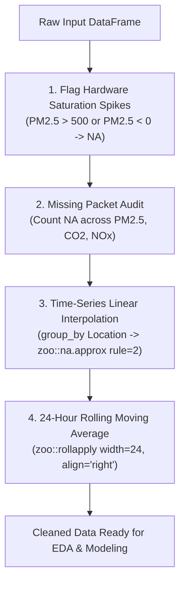

# Data Pipeline, Schema & Cleaning Procedures

This document provides a detailed breakdown of data origins, schema specifications, sensor artifact simulation, cleaning algorithms, and data leakage safeguards implemented in the **Campus Air Quality Monitoring, Analysis, and Forecasting** system.

---

## ⚠️ Data Origin & Critical Limitations

> [!IMPORTANT]
> **Data Origin Notice**: The datasets utilized in this project (`campus_air_quality_hourly_2025.csv` and `campus_air_quality_hourly_2026_test.csv`) are **100% synthetic/simulated**. They were programmatically generated by [`generate_synthetic_air_quality.py`](../generate_synthetic_air_quality.py) using mathematical equations that emulate diurnal solar cycles, Gaussian traffic peaks, human metabolic respiration, and atmospheric dispersion.
>
> While these equations closely mirror empirical physical dynamics, **all model forecast metrics (e.g., RMSE, MAE, MAPE) reflect simulated behavior rather than actual physical measurements from a university campus**. Performance on real-world low-cost IoT optical sensors may exhibit higher noise, unmodeled environmental cross-sensitivities, and irregular packet dropouts.

---

## 📋 Data Schema & Variable Definitions

The raw simulated datasets contain hourly observations across 8 distinct campus micro-environments for the entire year 2025 (8,760 hours $\times$ 8 locations = 70,080 records) and the first quarter of 2026 (2,160 hours $\times$ 8 locations = 17,280 records).

| Column Name | Data Type | Physical Units | Sampling Frequency | Range / Expected Values | Description |
| :--- | :--- | :--- | :--- | :--- | :--- |
| **`Timestamp`** | String / POSIXct | YYYY-MM-DD HH:MM:SS | Hourly | `2025-01-01 00:00:00` to `2026-03-31 23:00:00` | Chronological timestamp recorded in UTC time standard. |
| **`Location`** | String | Discrete Name | Categorical | 8 Station Names | Unique campus micro-environment location identifier. |
| **`Location_Type`** | String | Discrete Category | Categorical | `traffic_gate`, `parking`, `secondary_gate`, `indoor_study`, `indoor_dining`, `residential`, `recreational` | Functional categorization of the location. |
| **`PM2.5 (ug/m3)`** | Numeric (Float) | $\mu\text{g/m}^3$ | Hourly | $5.0$ to $380.0$ (Spikes: $999.0$) | Fine particulate matter with aerodynamic diameter $< 2.5\ \mu\text{m}$. Primary target variable for forecasting. |
| **`CO2 (ppm)`** | Numeric (Integer)| Parts Per Million (ppm) | Hourly | $380$ to $2,400$ | Carbon dioxide concentration; key indicator of human respiration and indoor HVAC adequacy. |
| **`NOx (ppb)`** | Numeric (Integer)| Parts Per Billion (ppb) | Hourly | $5$ to $160$ | Nitrogen oxides ($\text{NO} + \text{NO}_2$); primary chemical tracer for vehicular fossil fuel combustion. |
| **`Temperature (C)`**| Numeric (Float) | Degrees Celsius (°C) | Hourly | $7.0$ to $42.0$ | Ambient air temperature showing seasonal shifts and diurnal solar heating. |
| **`Relative_Humidity (%)`** | Numeric (Float)| Percentage (%) | Hourly | $20.0\%$ to $98.0\%$ | Relative humidity showing nocturnal elevation and monsoon surges. |
| **`Wind_Speed (m/s)`** | Numeric (Float) | Meters per second (m/s) | Hourly | $0.4$ to $5.2$ | Horizontal surface wind velocity; primary meteorological driver of pollutant dispersion. |
| **`Vehicle_Count`** | Numeric (Integer)| Vehicle Units / Hour | Hourly | $0$ to $320$ | Total vehicular volume passing the sensor station per hour. |
| **`Human_Footfall`** | Numeric (Integer)| Person Units / Hour | Hourly | $0$ to $360$ | Total pedestrian occupancy or footfall count within the micro-environment. |
| **`Event`** | String | Category | Discrete | `Normal`, `Festival`, `Holiday`, `Exam_Week` | Campus operational calendar regime. |
| **`AQI_Category`** | String | CPCB Standard Band | Discrete | `Good`, `Satisfactory`, `Moderate`, `Poor`, `Very Poor`, `Severe` | Air Quality Index category derived from $\text{PM}_{2.5}$ concentration breakpoints. |

---

## 🏫 Monitored Campus Micro-Environments

The platform monitors 8 distinct locations designed to test both outdoor traffic/dispersion dynamics and indoor occupant-driven air chemistry:

| Location | Category | Indoor / Outdoor | Base Vehicles | Base Footfall | Coordinates (Lat, Long) | Primary Physical Dynamic |
| :--- | :--- | :--- | :---: | :---: | :---: | :--- |
| **Main Gate** | `traffic_gate` | Outdoor | 140 | 90 | $28.5450^\circ\text{N}, 77.1920^\circ\text{E}$ | Heavy morning/evening commute traffic; high $\text{NO}_x$ and $\text{PM}_{2.5}$ combustion spikes. |
| **Parking Lot** | `parking` | Outdoor | 110 | 40 | $28.5442^\circ\text{N}, 77.1910^\circ\text{E}$ | Cold-start engine idling emissions and vehicle parking cycles. |
| **Back Gate Entry 1** | `secondary_gate` | Outdoor | 75 | 65 | $28.5495^\circ\text{N}, 77.1960^\circ\text{E}$ | Secondary campus entry for service deliveries and local transit. |
| **Back Gate Entry 2** | `secondary_gate` | Outdoor | 65 | 55 | $28.5488^\circ\text{N}, 77.1975^\circ\text{E}$ | Pedestrian-heavy secondary perimeter access. |
| **Library** | `indoor_study` | Indoor | 0 | 130 | $28.5465^\circ\text{N}, 77.1935^\circ\text{E}$ | Enclosed reading halls; HVAC filtration lowers $\text{PM}_{2.5}$ by $65\%$, but high student occupancy causes $\text{CO}_2$ buildup ($> 1,400\ \text{ppm}$). |
| **Canteen** | `indoor_dining` | Indoor | 5 | 160 | $28.5458^\circ\text{N}, 77.1945^\circ\text{E}$ | Meal-time footfall surges (breakfast, lunch, dinner) and commercial cooking exhaust surges. |
| **Hostel Area** | `residential` | Outdoor / Res | 20 | 110 | $28.5480^\circ\text{N}, 77.1950^\circ\text{E}$ | Residential living zone; elevated evening footfall and moderate localized emissions. |
| **Playground** | `recreational` | Outdoor | 0 | 85 | $28.5472^\circ\text{N}, 77.1925^\circ\text{E}$ | Open recreational grounds; early morning and late afternoon sports activity. |

---

## 🧹 Data Cleaning & Preprocessing Pipeline

The data cleaning pipeline is implemented in the `clean_dataset()` function within [`run_analysis_and_forecast.R`](../run_analysis_and_forecast.R#L37-L72). It operates deterministically through four sequential stages:



### 1. Hardware Anomaly & Saturation Detection
* **Physical Cause**: Optical laser particle counters can become saturated by moisture condensation, dust motes, or electrical transients, outputting full-scale voltage spikes (e.g., $999.0\ \mu\text{g/m}^3$). Negative values may also arise from zero-drift calibration errors.
* **Code Implementation**:
  ```r
  outlier_idx <- which(df$PM2.5..ug.m3. > 500 | df$PM2.5..ug.m3. < 0)
  df$PM2.5..ug.m3.[outlier_idx] <- NA
  ```
* **Observed Count**: In the 2025 raw dataset, **140 outlier records** ($> 500\ \mu\text{g/m}^3$) were identified and converted to `NA`.

### 2. Missing Value Imputation via Linear Interpolation
* **Why Row Deletion (`na.omit`) is Forbidden**: In discrete-time autoregressive modeling ($\text{ARIMA}$ / $\text{SARIMA}$), observations must reside on a strictly uniform time grid ($t, t-1, t-2$). Dropping missing rows collapses the time index, corrupting lag structures and destroying the 24-hour seasonal periodicity.
* **Why Mean Imputation is Forbidden**: Replacing missing night-time readings with the global annual mean introduces artificial step changes and dampens diurnal variance.
* **Code Implementation**:
  ```r
  df_clean <- df %>%
    group_by(Location) %>%
    arrange(Timestamp) %>%
    mutate(
      PM2.5_clean = na.approx(PM2.5..ug.m3., rule = 2),
      CO2_clean   = na.approx(CO2..ppm., rule = 2),
      NOx_clean   = na.approx(NOx..ppb., rule = 2)
    ) %>%
    ungroup()
  ```
* **Behavior of `rule = 2`**: Linearly bridges interior missing gaps between surrounding points. If missing values occur at the very start or end of the series, `rule = 2` extends the nearest boundary value to prevent remaining `NA` outputs.

### 3. Trailing 24-Hour Moving Average Feature Creation
* **Purpose**: Smooths high-frequency sensor noise and aligns with regulatory standards (e.g., WHO and CPCB 24-hour mean guidelines).
* **Code Implementation**:
  ```r
  df_clean <- df_clean %>%
    group_by(Location) %>%
    arrange(Timestamp) %>%
    mutate(
      PM2.5_24h_MA = round(rollapply(PM2.5_clean, width = 24, FUN = mean, align = "right", fill = NA), 1)
    ) %>%
    ungroup()
  ```
* **Alignment Note**: The moving average is calculated with `align = "right"`. This ensures that the moving average at hour $t$ utilizes only past observations ($t-23, \dots, t$) and **does not look ahead** into future time steps.

---

## 🛡️ Data Leakage Analysis

Data leakage occurs when information outside the training dataset is inadvertently used to train a machine learning model or compute transformations. Here is how the project guards against it:

| Pipeline Step | Leakage Risk Assessment | Code Implementation Status | Verification & Finding |
| :--- | :--- | :--- | :--- |
| **Train/Test Splitting** | Chronological Ordering | **Zero Leakage**: Strict temporal split. The training set is drawn exclusively from the trailing 14 days of 2025 (`2025-12-18 00:00:00` to `2025-12-31 23:00:00`). The evaluation test set is the first 24 hours of 2026 (`2026-01-01 00:00:00` to `23:00:00`). | Verified. Training and evaluation timestamps do not overlap. |
| **Imputation (`na.approx`)** | Cross-Split Leakage | **Separated Execution**: `clean_dataset()` is executed independently on `raw_data_2025` and `raw_data_2026`. No 2026 observations enter the 2025 interpolation window. | Verified. Both datasets are loaded and cleaned in separate function calls. |
| **Rolling Moving Average** | Look-Ahead Contamination | **Right-Aligned Window**: `rollapply(..., align = "right")` strictly references trailing observations ($t-23$ to $t$). | Verified. No forward-looking observations are used. |
| **SARIMAX Exogenous Regressors** | Future Covariate Availability | **Operational Assumption**: In the benchmark test, future values of `Vehicle_Count` and `Wind_Speed` for the 24 hours of January 1, 2026, are passed to `forecast(xreg = xreg_test)`. | **Assumed Foresight**: In a production setting, true future values are unavailable and must be supplied by campus traffic schedules and Numerical Weather Prediction (NWP) forecasts. |

---

## 🔍 Checklist for Deploying to Real Campus IoT Sensors

Before deploying this data pipeline to physical environmental hardware (e.g., Plantower PMS5003, Sensirion SPS30, or NDIR $\text{CO}_2$ sensors), an engineer must verify:

1. [ ] **Time Zone Uniformity**: Confirm all edge gateways log timestamps in a consistent standard (e.g., UTC or fixed IST without Daylight Saving shifts).
2. [ ] **Zero-Value vs. Dropout Differentiation**: Distinguish between actual zero readings (e.g., zero vehicles at 03:00 AM) and lost sensor packets (`NULL` / disconnection).
3. [ ] **Long-Duration Outage Handling**: Linear interpolation (`na.approx`) is valid only for brief outages (1–4 hours). If a sensor loses power for days, linear interpolation will draw a flat artificial ramp; multi-day outages should trigger sensor health alerts and structural gap flags.
4. [ ] **Relative Humidity Saturation**: Real optical sensors experience hygroscopic swelling at $\text{RH} > 75\%$. Confirm whether hardware firmware applies heated inlet drying or algorithmic hygroscopic growth correction factors.
5. [ ] **Cross-Sensor Calibration Drift**: Low-cost sensors drift over 6–12 months. Periodic baseline alignment against a reference municipal monitoring station (e.g., CPCB continuous ambient air station) is required.
