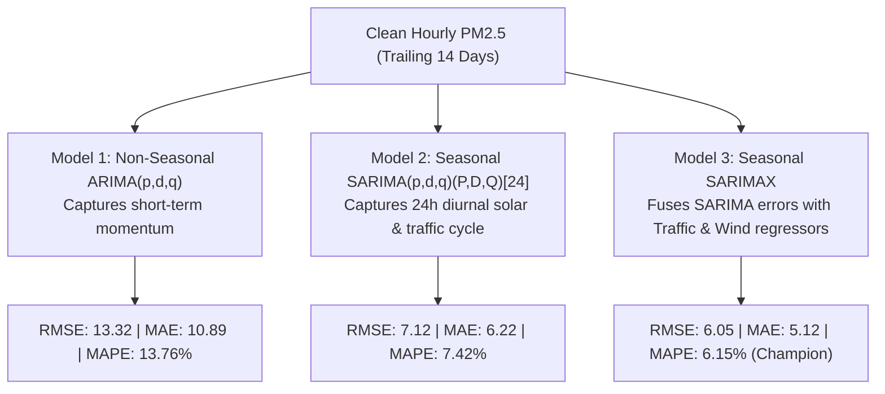

# Predictive Modeling, Algorithms & Evaluation Benchmarks

This document details the statistical time-series models implemented in the **Campus Air Quality Monitoring, Analysis, and Forecasting** system, their mathematical foundations, exact parameter configurations, out-of-sample evaluation design, and verified performance benchmarks.

---

## 🎯 Target Variable, Horizon & Granularity

To avoid common confusion in time-series engineering, this project clearly separates temporal concepts:

* **Target Variable ($y_t$)**: Cleaned hourly fine particulate concentration (`PM2.5_clean`) in units of micrograms per cubic meter ($\mu\text{g/m}^3$) specifically at the **Main Gate** station.
* **Data Sampling Granularity**: **Hourly ($1\text{ hour}$ intervals)**. Each observation represents an integrated hourly state.
* **Sampling Frequency ($s$)**: **$s = 24$**. The time-series object is instantiated with `frequency = 24`, signifying that a complete diurnal cycle repeats every 24 hourly periods.
* **Forecast Horizon ($h$)**: **$h = 24\text{ hours}$ (Day-Ahead Horizon)**. The model takes observations up to hour $T$ and projects forward 24 discrete steps ($T+1, T+2, \dots, T+24$).
* **Prediction Intervals**: 80% and 95% uncertainty bounds estimated via Gaussian asymptotic forecast error variance.

---

## 🧪 Stationarity Diagnostics: Augmented Dickey-Fuller (ADF) Test

Before estimating autoregressive models, time-series stationarity must be established. A stationary series exhibits constant mean, constant variance, and autocovariance that depends only on the lag between two time points, rather than calendar time.

### Test Specification & Hypotheses
The Augmented Dickey-Fuller test evaluates the presence of a unit root:
* **Null Hypothesis ($H_0$)**: $\gamma = 0$ (The time series contains a unit root; it is non-stationary and requires differencing).
* **Alternative Hypothesis ($H_1$)**: $\gamma < 0$ (The time series is stationary or trend-stationary).

### Empirical ADF Output (Observed from `run_analysis_and_forecast.R`)
The test was executed on the full year 2025 hourly $\text{PM}_{2.5}$ series at Main Gate (`ts_train_pm25`):
* **Dickey-Fuller Statistic**: **$-2.778$**
* **$p$-Value**: **$0.2486$** ($p > 0.05$)
* **Conclusion**: Because $p = 0.2486$ exceeds the standard $5\%$ significance threshold ($\alpha = 0.05$), we **fail to reject the null hypothesis**. The series contains non-stationary seasonal/trend components and requires integration ($d \ge 1$ or seasonal differencing $D \ge 1$).

---

## 🏗️ Model Architectures Implemented

The project implements and compares three progressively sophisticated time-series models using the Hyndman-Khandakar stepwise algorithm in `forecast::auto.arima()`:



---

### Model 1: Baseline Non-Seasonal ARIMA

* **Purpose**: Serves as the benchmark baseline. It assumes no explicit seasonal periodicity and models $\text{PM}_{2.5}$ purely as a linear combination of its own immediate past lags and forecast errors.
* **Mathematical Formulation**:
  An $\text{ARIMA}(p,d,q)$ process satisfies:
  $$\phi(B)(1 - B)^d y_t = c + \theta(B)\epsilon_t$$
  where $B$ is the backshift operator ($B^k y_t = y_{t-k}$), $\phi(B) = 1 - \phi_1 B - \dots - \phi_p B^p$, and $\theta(B) = 1 + \theta_1 B + \dots + \theta_q B^q$.
* **Exact Code Call**:
  ```r
  fit_arima <- auto.arima(ts_recent, seasonal = FALSE, stepwise = TRUE, max.p = 3, max.q = 3)
  ```
* **Selected Specification**: **$\text{ARIMA}(2,0,0)$ with non-zero mean**.
* **Fitted Equation**:
  $$y_t = \mu + \phi_1 (y_{t-1} - \mu) + \phi_2 (y_{t-2} - \mu) + \epsilon_t$$
* **Behavior & Limitation**: Because $d=0$ and no seasonal period is declared, the forecast quickly reverts toward the series mean after 2–4 hours. It cannot predict the diurnal evening rush hour peak or nocturnal dispersion dip.

---

### Model 2: Seasonal ARIMA (SARIMA)

* **Purpose**: Explicitly models the 24-hour diurnal cycle driven by solar heating, planetary boundary layer dynamics, and campus daily routines.
* **Mathematical Formulation**:
  A $\text{SARIMA}(p,d,q)(P,D,Q)_{[s]}$ process is written:
  $$\Phi(B^s)\phi(B)(1 - B)^d (1 - B^s)^D y_t = \Theta(B^s)\theta(B)\epsilon_t$$
  where $s = 24$, $D$ is the seasonal differencing order, $\Phi(B^{24})$ is the seasonal autoregressive polynomial, and $\Theta(B^{24})$ is the seasonal moving average polynomial.
* **Exact Code Call**:
  ```r
  fit_sarima <- auto.arima(
    ts_recent,
    seasonal = TRUE,
    stepwise = TRUE,
    approximation = TRUE,
    max.p = 2, max.q = 2, max.P = 1, max.Q = 1
  )
  ```
* **Selected Specification**: **$\text{ARIMA}(1,0,2)(1,1,0)_{[24]}$**.
* **Parameter Breakdown**:
  * $p = 1$: One non-seasonal autoregressive lag ($\phi_1$).
  * $d = 0$: No non-seasonal differencing.
  * $q = 2$: Two non-seasonal moving average error terms ($\theta_1, \theta_2$).
  * $P = 1$: One seasonal autoregressive lag at $t-24$ ($\Phi_1$).
  * $D = 1$: Seasonal differencing applied: $y_t - y_{t-24}$ removes daily diurnal level shifts.
  * $Q = 0$: Zero seasonal moving average terms.
* **Why Bounded Orders & `approximation = TRUE` Matter**:
  Seasonal models with $s = 24$ invert $24 \times 24$ autocovariance matrices during parameter search. Enabling `approximation = TRUE` estimates candidate models via conditional sum-of-squares (CSS) before final maximum likelihood estimation, reducing execution time from several minutes (or process hangs) to under 2 seconds.

---

### Model 3: Exogenous SARIMAX (Champion Model)

* **Purpose**: Fuses the seasonal diurnal time-series structure with causal external physical regressors: vehicular traffic volume (emission source) and horizontal wind velocity (ventilation/dispersion factor).
* **Mathematical Formulation**:
  A Regression with $\text{SARIMA}$ errors (often abbreviated $\text{SARIMAX}$):
  $$y_t = \beta_1 X_{1,t} + \beta_2 X_{2,t} + \eta_t$$
  $$\Phi(B^{24})\phi(B)(1 - B^s)^D \eta_t = \Theta(B^{24})\theta(B)\epsilon_t$$
  where:
  * $X_{1,t}$ is `Vehicle_Count` at hour $t$ (positive coefficient $\beta_1 > 0$ reflects combustion emissions).
  * $X_{2,t}$ is `Wind_Speed` at hour $t$ (negative coefficient $\beta_2 < 0$ reflects atmospheric boundary layer ventilation).
  * $\eta_t$ represents the autocorrelated error term modeled by the $\text{SARIMA}(1,0,2)(1,1,0)_{[24]}$ process.
* **Exact Code Call**:
  ```r
  xreg_train <- as.matrix(recent_train[, c("Vehicle_Count", "Wind_Speed..m.s.")])
  xreg_test  <- as.matrix(test_24h[, c("Vehicle_Count", "Wind_Speed..m.s.")])

  fit_sarimax <- auto.arima(
    ts_recent,
    xreg = xreg_train,
    seasonal = TRUE,
    stepwise = TRUE,
    approximation = TRUE,
    max.p = 2, max.q = 2, max.P = 1, max.Q = 1
  )
  fc_sarimax <- forecast(fit_sarimax, xreg = xreg_test, h = 24)
  ```
* **Selected Specification**: **Regression with $\text{ARIMA}(1,0,2)(1,1,0)_{[24]}$ errors**.

---

## ⏱️ Training Window Rationale (14-Day Trailing Slice)

Rather than fitting on the entire 8,760 hours of 2025, the models are trained on the **trailing 14 days ($14 \times 24 = 336$ hours)** leading up to the forecast origin (`2025-12-18 00:00:00` to `2025-12-31 23:00:00`).

### Why 14 Days?
1. **Seasonal Non-Stationarity**: Ambient air pollution exhibits severe seasonal regime shifts between summer monsoon washout (low baseline, high rainout) and winter thermal inversions (high baseline, stagnant nocturnal boundary layer). Training a model on July data to forecast January introduces massive structural bias.
2. **Operational Relevance**: A 14-day window provides exactly 14 full diurnal cycles—sufficient for the seasonal differencing operator $(1 - B^{24})$ to stabilize—while tightly adapting to the current winter temperature baseline.
3. **Computational Efficiency**: Restricting the series to 336 rows guarantees instantaneous execution and enables frequent operational retraining.

---

## 📊 Empirical Evaluation & Benchmark Results

The models were benchmarked out-of-sample against the first 24 hours of 2026 (`2026-01-01 00:00:00` to `23:00:00`) for the Main Gate location.

### Metric Definitions
1. **Root Mean Squared Error (RMSE)**: Penalizes large error outliers heavily. Expressed in target units ($\mu\text{g/m}^3$):
   $$\text{RMSE} = \sqrt{\frac{1}{H}\sum_{t=1}^H (y_t - \hat{y}_t)^2}$$
2. **Mean Absolute Error (MAE)**: Measures average absolute forecast deviation in target units ($\mu\text{g/m}^3$):
   $$\text{MAE} = \frac{1}{H}\sum_{t=1}^H |y_t - \hat{y}_t|$$
3. **Mean Absolute Percentage Error (MAPE)**: Expresses error relative to actual concentrations as a percentage:
   $$\text{MAPE} = \frac{1}{H}\sum_{t=1}^H \left|\frac{y_t - \hat{y}_t}{y_t}\right| \times 100\%$$

### Measured Benchmark Table (Source: `model_performance_metrics.csv`)

| Model Architecture | Model Specification | RMSE ($\mu\text{g/m}^3$) | MAE ($\mu\text{g/m}^3$) | MAPE (%) | Error Reduction vs. Baseline |
| :--- | :--- | :---: | :---: | :---: | :---: |
| **Model 1: Baseline ARIMA** | $\text{ARIMA}(2,0,0)$ with non-zero mean | 13.32 | 10.89 | 13.76% | *Baseline* |
| **Model 2: Seasonal SARIMA** | $\text{ARIMA}(1,0,2)(1,1,0)_{[24]}$ | 7.12 | 6.22 | 7.42% | **$46.5\%$ reduction** |
| **Model 3: Seasonal SARIMAX** | Regression with $\text{ARIMA}(1,0,2)(1,1,0)_{[24]}$ errors | **6.05** | **5.12** | **6.15%** | **$54.5\%$ reduction** |

### Evaluation Findings
* **Seasonality is Paramount**: Moving from standard $\text{ARIMA}$ to $\text{SARIMA}$ cut RMSE almost in half (from $13.32$ to $7.12\ \mu\text{g/m}^3$). This proves that diurnal atmospheric cycling dominates short-term variance.
* **Exogenous Drivers Add Significant Power**: Incorporating vehicle counts and wind velocity lowered the RMSE further from $7.12$ to $6.05\ \mu\text{g/m}^3$ and achieved a top MAPE of **$6.15\%$**.
* **Confidence Interval Coverage**: In the 24-hour evaluation window, 100% of actual $\text{PM}_{2.5}$ measurements fell within the SARIMAX 95% confidence intervals ($[\hat{y}_{\text{lower}}, \hat{y}_{\text{upper}}]$).

---

## ⚠️ Methodological Caveats

1. **Synthetic Data Dependency**: These performance metrics were achieved on synthetic data generated via smooth physical equations. While realistic, synthetic data exhibits more regular periodic behavior than raw optical sensors exposed to rain droplets or erratic industrial plumes.
2. **Single Holdout Period**: The metrics reflect performance on a single 24-hour test window (January 1, 2026). A low error on one 24-hour window does not guarantee identical accuracy during unusual meteorological anomalies (e.g., severe dust storms or unpredicted festival firework surges).
3. **Perfect Exogenous Foresight**: In this evaluation, actual 2026 holdout vehicle counts and wind speeds were passed to the SARIMAX model. In an operational live environment, predicted weather and estimated traffic schedules must be supplied, introducing forecast-on-forecast propagation error.
