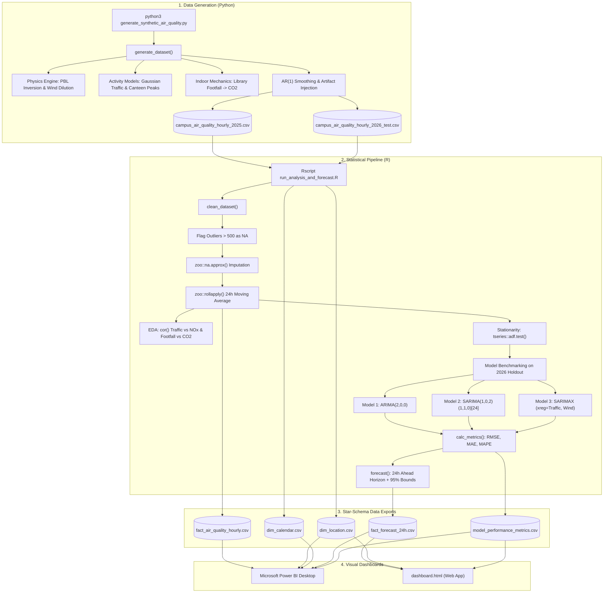

# Code Execution & Data Flow Architecture (`flow.md`)

This document details the execution flow, file dependencies, module interactions, and data pathways across the **Campus Air Quality Monitoring, Analysis & Forecasting** system.

---

## A. Project Entry Points

The project is structured into three sequential operational stages. Execution begins from the command line:

```
[Stage 1: Generation]                  [Stage 2: Statistical Modeling]         [Stage 3: Visual Analytics]
python3 generate_synthetic_air_quality.py ──► Rscript run_analysis_and_forecast.R ──► Open dashboard.html / Power BI
                                          └──► Rscript predict_tomorrow_24h.R   ──► Generates tomorrow_24h_forecast.csv
```

1. **Stage 1 (Data Synthesis Engine)**:
   * **Entry Command**: `python3 generate_synthetic_air_quality.py`
   * **Initial Function**: `__main__` block invoking `generate_dataset()`.
2. **Stage 2 (Cleaning, Statistical Modeling & Forecasting)**:
   * **Entry Command**: `Rscript run_analysis_and_forecast.R`
   * **Initial Execution**: Top-level script sequence loading libraries and executing `clean_dataset()`.
3. **Stage 3 (Visualization & Decision Support)**:
   * **Web Dashboard**: Opening `dashboard.html` in any standard web browser.
   * **Enterprise BI**: Importing exported star-schema CSVs into **Microsoft Power BI Desktop** following `POWER_BI_DASHBOARD_GUIDE.md`.

---

## B. Execution Sequence

The complete execution sequence progresses through 6 sequential phases:

```
Phase 1: Simulation (Python)
  └─► generate_dataset(2025) ──────► Writes campus_air_quality_hourly_2025.csv
  └─► generate_dataset(2026) ──────► Writes campus_air_quality_hourly_2026_test.csv

Phase 2: Ingestion & Cleaning (R)
  └─► read.csv() ──────────────────► Ingests 2025 (70,080 rows) and 2026 (17,280 rows)
  └─► clean_dataset() ─────────────► Flags outliers (>500 ug/m3) as NA
  └─► zoo::na.approx() ────────────► Linear interpolation per Location
  └─► zoo::rollapply() ────────────► Computes 24h trailing moving average

Phase 3: Exploratory Analytics (R)
  └─► dplyr::summarise() ──────────► Generates location environmental summaries
  └─► cor() ───────────────────────► Calculates Vehicle<->NOx and Footfall<->CO2 correlations

Phase 4: Stationarity Diagnostics (R)
  └─► stats::ts(..., freq=24) ─────► Constructs hourly time-series object
  └─► tseries::adf.test() ─────────► Augmented Dickey-Fuller test (verifies non-stationarity)

Phase 5: Model Training & Evaluation (R)
  └─► forecast::auto.arima() ──────► Model 1: Non-seasonal ARIMA(2,0,0)
  └─► forecast::auto.arima() ──────► Model 2: Seasonal SARIMA(1,0,2)(1,1,0)[24]
  └─► forecast::auto.arima() ──────► Model 3: SARIMAX (with Traffic & Wind xreg)
  └─► forecast::forecast() ────────► Predicts 24-hour horizon with 80% & 95% intervals
  └─► calc_metrics() ──────────────► Evaluates RMSE, MAE, MAPE against holdout test data

Phase 6: Relational Export (R)
  └─► utils::write.csv() ──────────► Exports fact_air_quality_hourly.csv
  └─► utils::write.csv() ──────────► Exports dim_location.csv
  └─► utils::write.csv() ──────────► Exports dim_calendar.csv
  └─► utils::write.csv() ──────────► Exports fact_forecast_24h.csv
  └─► utils::write.csv() ──────────► Exports model_performance_metrics.csv
```

---

## C. File & Module Interactions

The file interaction matrix below shows how artifacts and code modules depend on each other:

| Source File / Component | Upstream Dependency | Downstream Dependents | Responsibility |
| :--- | :--- | :--- | :--- |
| **`generate_synthetic_air_quality.py`** | None (Python Standard Library) | `campus_air_quality_hourly_2025.csv`<br>`campus_air_quality_hourly_2026_test.csv` | Simulates atmospheric physics, human activity, and generates raw CSVs |
| **`run_analysis_and_forecast.R`** | `campus_air_quality_hourly_2025.csv`<br>`campus_air_quality_hourly_2026_test.csv`<br>R Packages: `forecast`, `zoo`, `dplyr`, `tseries` | `fact_air_quality_hourly.csv`<br>`dim_location.csv`<br>`dim_calendar.csv`<br>`fact_forecast_24h.csv`<br>`model_performance_metrics.csv` | Cleans sensor glitches, runs ADF tests, fits ARIMA/SARIMA/SARIMAX, evaluates models, and exports the Star Schema |
| **`dashboard.html`** | CDN Libraries:<br>Tailwind CSS, Chart.js, Leaflet.js | End-User Browser View | Renders interactive GPS campus map, 24h forecast curve with 95% confidence intervals, and activity correlation plots |
| **`POWER_BI_DASHBOARD_GUIDE.md`** | Exported Star-Schema CSVs | Power BI Desktop (`.pbix`) | Documentation detailing data model relationships, DAX formulas, and visual dashboard layouts |

---

## D. Data Flow Architecture

The data travels through 5 distinct states from physical generation to executive visualization:

```
[1. Synthetic Generation]
   Raw physical variables (Hour, Season, Wind, Traffic, Occupancy)
   ├── AR(1) state smoothing
   └── Injection of missing packets (NA) and saturation spikes (999.0)
         │
         ▼
[2. Raw Storage]
   campus_air_quality_hourly_2025.csv (70,080 rows)
   campus_air_quality_hourly_2026_test.csv (17,280 rows)
         │
         ▼
[3. Statistical Transformation (In R)]
   ├── Filtering: Values > 500 ug/m3 or < 0 set to NA
   ├── Imputation: zoo::na.approx() per Location
   ├── Aggregation: 24h trailing rolling mean (zoo::rollapply)
   └── Differentiation & Lag estimation (auto.arima)
         │
         ▼
[4. Dimensional Star-Schema Storage]
   ├── fact_air_quality_hourly.csv (Clean measurements & rolling MA)
   ├── dim_location.csv (GPS coordinates, environment classification)
   ├── dim_calendar.csv (Date attributes, day-of-week, weekend flags)
   ├── fact_forecast_24h.csv (Actuals vs SARIMA vs SARIMAX with bounds)
   └── model_performance_metrics.csv (RMSE, MAE, MAPE benchmarks)
         │
         ▼
[5. Consumption Layer]
   ├── dashboard.html (Interactive web app with Leaflet & Chart.js)
   └── Microsoft Power BI (Executive P&L/Safety dashboards via DAX)
```

---

## E. Execution Flow Diagram



---

## F. Important Execution Paths

### Path 1: Synthetic Data Generation Path
1. Script invokes `generate_dataset()` with start date `2025-01-01` and end date `2025-12-31`.
2. A 48-hour burn-in period (`start_date - 48 hours`) initializes state variables to prevent cold-start artifacts.
3. For each hour, `get_day_type()` evaluates whether the date is a *Festival*, *Holiday*, *Exam_Week*, or *Normal* day.
4. Meteorology is calculated: `temperature` uses a 24h sine wave, `relative_humidity` is inversely proportional, and `dispersion_factor` simulates boundary layer expansion.
5. Loop iterates across all 8 locations: computes vehicle counts, human footfall, target $\text{PM}_{2.5}$, $\text{CO}_2$, and $\text{NO}_x$.
6. Autoregressive updates smooth the state: $\text{AR}_{t} = 0.78 \cdot \text{AR}_{t-1} + 0.22 \cdot \text{Target} + \epsilon$.
7. Random artifacts ($0.8\%$ `NA`, $0.2\%$ spikes) are injected if `inject_cleaning_artifacts = True`.
8. Rows are flushed to disk via `csv.DictWriter`.

### Path 2: Data Cleaning & Preprocessing Path
1. `read.csv()` loads the raw CSVs into R data frames.
2. `clean_dataset()` identifies elements where $\text{PM}_{2.5} > 500$ or $< 0$, setting them to `NA`.
3. `group_by(Location)` partitions the dataset by location to prevent cross-sensor interpolation.
4. `zoo::na.approx(..., rule = 2)` replaces missing values using linear interpolation.
5. `zoo::rollapply(..., width = 24, align = "right")` computes trailing 24-hour moving averages.
6. The cleaned data frame is returned and stored in `data_2025_clean`.

### Path 3: Stationarity Diagnostic & Model Selection Path
1. Filters cleaned data for `Location == "Main Gate"`.
2. Converts the clean $\text{PM}_{2.5}$ column into an R time-series object: `ts(..., frequency = 24)`.
3. Runs `tseries::adf.test()`: outputs Dickey-Fuller statistic ($-2.778$, $p = 0.2486$). The null hypothesis of non-stationarity cannot be rejected; first-order differencing ($d = 1$) is required.
4. Slices the trailing 14 days ($14 \times 24 = 336$ rows) as the training set `ts_recent`.
5. Fits **Model 1 (ARIMA)** using `auto.arima(ts_recent, seasonal = FALSE)`. Result: $\text{ARIMA}(2,0,0)$.
6. Fits **Model 2 (SARIMA)** using `auto.arima(ts_recent, seasonal = TRUE, approximation = TRUE)`. Result: $\text{ARIMA}(1,0,2)(1,1,0)_{[24]}$.
7. Fits **Model 3 (SARIMAX)** using `auto.arima(ts_recent, xreg = xreg_train, seasonal = TRUE)`. Result: Regression with $\text{ARIMA}(1,0,2)(1,1,0)_{[24]}$ errors.
8. Evaluates predictions against the first 24 hours of 2026: calls `calc_metrics()` to record RMSE, MAE, and MAPE.
9. Exports forecast data frame (`fact_forecast_24h.csv`) containing point predictions and $95\%$ confidence bounds.

---

## G. Function Call Reference

### Python (`generate_synthetic_air_quality.py`)

| Function Name | Parameters | Direct Calls | Purpose |
| :--- | :--- | :--- | :--- |
| **`get_day_type(dt)`** | `dt` (`datetime`) | None | Determines calendar regime (*Festival*, *Holiday*, *Exam_Week*, *Normal*) based on month, day, and weekday. |
| **`get_pm25_category(pm25)`** | `pm25` (`float`) | None | Categorizes $\text{PM}_{2.5}$ into CPCB AQI bands (*Good*, *Satisfactory*, *Moderate*, *Poor*, *Very Poor*, *Severe*). |
| **`generate_dataset(...)`** | `start_date`, `end_date`, `output_filename`, `inject_cleaning_artifacts` | `get_day_type()`, `get_pm25_category()`, `math.sin()`, `math.exp()`, `random.gauss()` | Core simulation loop; calculates physics, human footfall, vehicle counts, autoregressive smoothing, and writes CSV records. |

### R (`run_analysis_and_forecast.R`)

| Function Name | Parameters | Direct / Package Calls | Purpose |
| :--- | :--- | :--- | :--- |
| **`clean_dataset(df)`** | `df` (Data Frame) | `dplyr::group_by()`, `dplyr::mutate()`, `zoo::na.approx()`, `zoo::rollapply()` | Eliminates saturation spikes ($>500$), executes linear time-series interpolation, and computes 24h rolling averages. |
| **`calc_metrics(actual, pred)`** | `actual` (vector), `pred` (vector) | `mean()`, `sqrt()`, `abs()` | Computes RMSE, MAE, and MAPE between ground truth holdout data and model forecasts. |
| **`tseries::adf.test()`** | `x` (`ts` object) | Framework function | Computes the Augmented Dickey-Fuller test statistic and $p$-value for unit roots. |
| **`forecast::auto.arima()`** | `y`, `xreg`, `seasonal`, `stepwise`, `approximation` | Framework function | Conducts Hyndman-Khandakar AICc minimization search to find optimal $(p,d,q)(P,D,Q)$ orders. |
| **`forecast::forecast()`** | `object` (fitted model), `xreg`, `h` | Framework function | Extrapolates future trajectory $h$ steps ahead, computing $80\%$ and $95\%$ prediction intervals. |
| **`utils::write.csv()`** | `x` (data frame), `file` | Base R | Flushes Star Schema tables to disk for Power BI and web consumption. |

### Web Client (`dashboard.html`)

| Component / Function | Technology | Direct Calls | Purpose |
| :--- | :--- | :--- | :--- |
| **`L.map()` / `L.circleMarker()`** | Leaflet.js | OpenStreetMap / CartoDB tiles | Renders interactive GPS campus map with dynamic color-coded markers for all 8 locations. |
| **`new Chart(ctxForecast, ...)`** | Chart.js | Canvas 2D API | Renders the 24-hour horizon comparing Actuals, SARIMA, SARIMAX, and the shaded $95\%$ confidence ribbon. |
| **`new Chart(ctxTraffic, ...)`** | Chart.js | Canvas 2D API | Renders the scatter plot demonstrating correlation between gate traffic volume and combustion $\text{NO}_x$. |
| **`new Chart(ctxRespiration, ...)`**| Chart.js | Canvas 2D API | Renders the dual-axis chart showing indoor library footfall driving metabolic $\text{CO}_2$ accumulation. |
